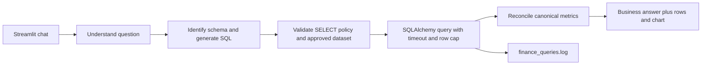

# CFO Finance Assistant – Agentic Text-to-SQL

A portfolio-ready, read-only finance analytics assistant built with Python, LangGraph, SQLAlchemy, SQL Server, OpenAI, Pydantic-ready typed state, and Streamlit. It demonstrates a guarded natural-language-to-SQL workflow, canonical finance formulas, synthetic reproducible data, query evidence, and an executable evaluation harness.

> **Data note:** all included finance data is generated synthetic data. It is not company reporting. Choose either a separately generated United States dataset in USD or India dataset in INR from the sidebar. India values are generated independently; they are not converted from USD with an assumed FX rate. South has an intentionally lower gross margin in Q2 2026 so root-cause comparisons have a reproducible signal in each market.

## Run locally (demo mode)

Python 3.11–3.13 is supported; Python 3.12 is recommended for the smoothest Windows package installs. The deterministic demo mode uses a fresh in-memory SQLite execution target backed by the same generated sample rows; no SQL Server or API key is needed.

```powershell
py -V:3.12 -m venv .venv
.venv\Scripts\Activate.ps1
pip install -e ".[dev]"
streamlit run app/ui.py
```

Open the URL Streamlit prints (normally http://localhost:8501). Configure `OPENAI_API_KEY` in `.env` to enable OpenAI SQL generation. Without it, the starter templates keep the app runnable and predictable.

The landing dashboard shows the synthetic revenue trend and regional gross margin. One-click prompt chips surface the example workflows, and each answer separates results, generated SQL, and run metadata into tabs. Query history and metric definitions remain available in the sidebar.

## Run SQL Server with Docker

Copy `.env.example` to `.env`, set a strong `MSSQL_SA_PASSWORD`, and optionally provide an OpenAI key. Then run:

```powershell
docker compose up --build
```

The compose setup starts SQL Server 2022, seeds both market datasets once, and starts the Streamlit app:

```powershell
docker compose logs -f app
```

Then open http://localhost:8501. The default SQLAlchemy URL in `.env.example` uses ODBC Driver 18 and certificate trust for local development. Use a dedicated SQL login with only `SELECT` on `dbo.fact_finance` outside the demo.

For a separately running SQL Server, run `python scripts/init_db.py` with `DATABASE_URL` set before launching the app. This applies the market/currency schema migration and adds missing sample rows for each market.

## Architecture



The graph nodes are implemented in `app/agent.py`. SQL policy lives in `app/security.py`; shared metric semantics are in `app/metrics.py`. The sole approved relation is `dbo.fact_finance`, with market, currency, date, region, product, segment, revenue, and cost fields. Every assistant query is scoped to the selected market. The SQL Server initializer migrates an existing table with default US/USD labels and adds the India dataset without duplicating existing rows.

## Financial definitions

- Revenue = sum of revenue.
- Cost = sum of cost.
- Gross profit = revenue minus cost.
- Gross margin = gross profit divided by revenue. Ratios are recalculated from grouped totals; averages of row or group margins are not used.
- Currency is shown in the selected dataset's native units: USD for the United States, INR for India. The two sample datasets are independent; no foreign-exchange conversion is implied. Periods use calendar quarters.

The root-cause template compares South Q2 2026 with Q1 2026 and reports actual product-level revenue, cost, and margin movements. It explicitly describes contribution evidence rather than asserting causal certainty.

## Safety and limitations

Only a single `SELECT` using the approved fact dataset passes the policy. DML/DDL, comments, multiple statements, system objects, and other tables are blocked. SQL is logged to `finance_queries.log`; SQL Server lock and connection timeouts are configured. `TOP (500)` is added when absent. These application checks are defense in depth, not a replacement for a read-only SQL Server database identity and network controls.

The demo templates cover the showcased question families. OpenAI mode asks the model for SQL but then runs it through the same guard and SQL Server execution path. The starter implementation does not infer unsupported metrics and may ask for a more specific question in a production extension. Evaluation token usage is not fabricated; provider token accounting is marked unavailable until wired to the chosen API response/accounting system.

## Evaluation

See [evaluation-report.md](evaluation-report.md) for the current measurement status and definitions. Run the repeatable 40-question fixture evaluation:

```powershell
python -m app.evaluation
```

This writes `evaluation-results.json` with the observed SQL execution rate, strict numeric accuracy, individual gold/observed values, and wall-clock latency. It computes results at runtime rather than claiming a pre-measured score. Extend `tests/` for SQL safety and data invariants, then run `pytest`.

The suite is intentionally starter-level: it tests known-value question families and several ambiguity/unsafe-prompt cases on synthetic data. Add broader SQL parse equivalence, answer extraction scoring, and real SQL Server integration before using this for financial reporting.

## Screenshots


These screenshots were added to the GitHub repository by the project owner.
